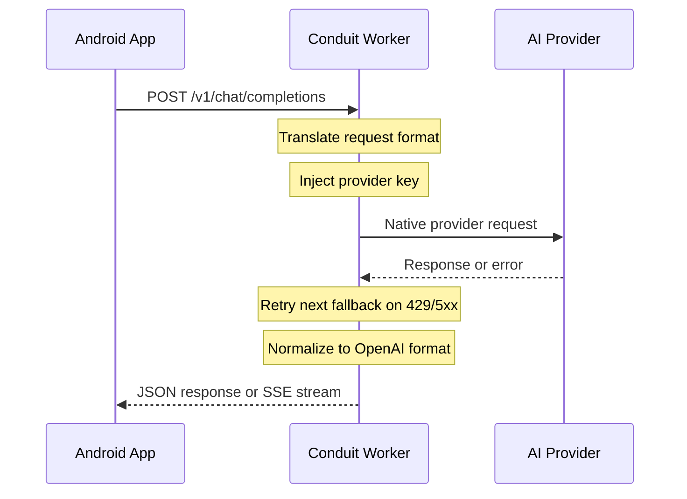
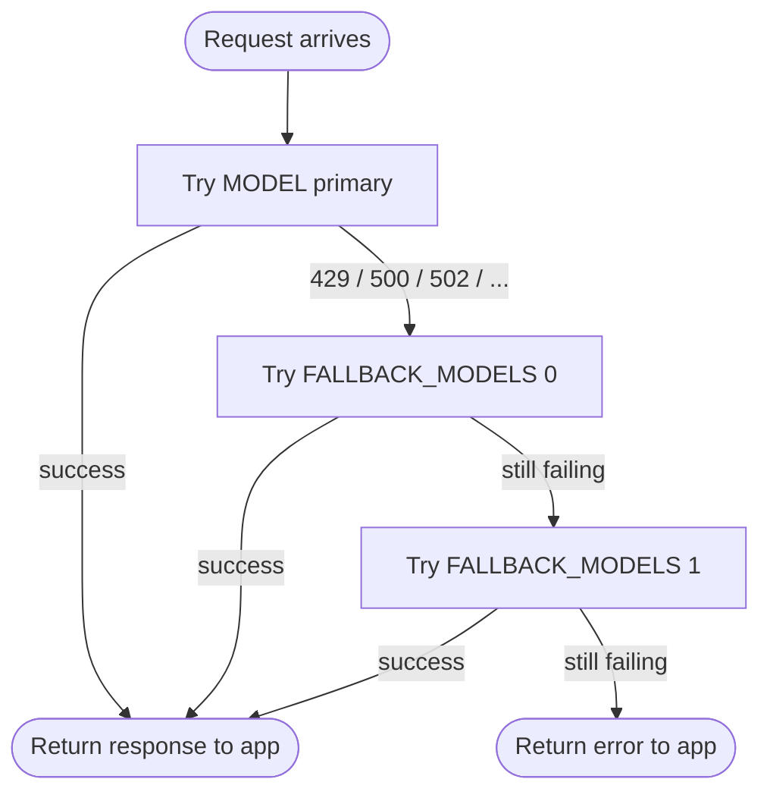

# Conduit — AI Gateway for Android, hosted on Cloudflare Workers

> A zero-config Cloudflare Worker that acts as a secure AI gateway for Android apps. Your app never bundles a provider key. Swap models and providers server-side with no app update required.

---

## What it does

Conduit is a Cloudflare Worker that sits between your Android app and whichever AI provider you choose. Your app always sends the same standard request. The Worker translates it, forwards it to the configured provider, and streams the response back — all without your app knowing or caring which model or service is behind it.



Provider credentials live exclusively in Cloudflare Worker secrets. The app only knows the Worker URL and an optional lightweight proxy key.

---

## Features

- **Multi-provider** — native adapters for Anthropic (Claude), Google AI Studio (Gemini), and any OpenAI-compatible API
- **Automatic fallbacks** — define an ordered chain of models; Conduit retries the next one when a provider rate-limits or errors
- **Zero keys in APK** — provider secrets live in Cloudflare secrets, never in compiled client code
- **Single stable endpoint** — swap providers or models server-side with no app update
- **Streaming (SSE)** — `stream: true` reaches the app token by token with no buffering
- **Optional client auth** — `PROXY_API_KEY` restricts the Worker to your app only
- **Model allowlist** — lock down which models the app is permitted to request
- **CORS ready** — configure origins for WebView or browser-based testing
- **Free to host** — fits within Cloudflare Workers' free tier (100k requests/day)

---

## Supported Providers

### Native adapters

These providers have a dedicated translation layer in Conduit. Set `PROVIDER` to the value shown.

| Provider | `PROVIDER` | What Conduit does |
|---|---|---|
| **Anthropic (Claude)** | `anthropic` | Translates the chat request to the Anthropic Messages API; normalizes the response back to the client contract |
| **Google AI Studio (Gemini)** | `google` | Uses the official `@google/genai` SDK; streams via SSE just like other providers |

### OpenAI-compatible providers

These APIs speak the OpenAI format natively. Set `PROVIDER=openai` and point `UPSTREAM_URL` at the provider's `/v1` base URL.

| Provider | `UPSTREAM_URL` | Notes |
|---|---|---|
| **OpenAI** | `https://api.openai.com/v1` | `gpt-6-astra`, `gpt-5.6-terra`, `gpt-5`, and more |
| **OpenRouter** | `https://openrouter.ai/api/v1` | 100+ models from one API key; use `moonshotai/kimi-k3` here too |
| **Perplexity** | `https://api.perplexity.ai` | Web-grounded models: `sonar-pro`, `sonar-reasoning-pro`, `sonar` |
| **Groq** | `https://api.groq.com/openai/v1` | Ultra-fast inference; hosts `moonshotai/kimi-k2-instruct-0905` |
| **Kimi (Moonshot AI)** | `https://api.moonshot.ai/v1` | `kimi-k3`, `kimi-k2.6`, `kimi-k2.7-code` |
| **Together AI** | `https://api.together.xyz/v1` | Open-source model hosting |
| **Nvidia NIM** | `https://integrate.api.nvidia.com/v1` | Llama, Mistral, and more |
| **Any `/v1` API** | your endpoint | Conduit forwards requests as-is |

> You can mix strategies for resilience: set `PROVIDER=openai` with OpenRouter as the primary, then add Groq or Perplexity models as fallbacks — all through a single API key if you use OpenRouter.

---

## Fallback Models

Fallbacks are the main resilience tool. When a provider returns a retryable error (`408`, `429`, `500`, `502`, `503`, `504`, …), Conduit automatically retries the next model in the chain without the app seeing a failure.

### How the chain works



### Configuration

```ini
MODEL=claude-fable-5              # primary — most capable
FALLBACK_MODELS=claude-opus-5,claude-sonnet-5
```

**Rules to keep in mind:**

- Fallback models must belong to the same provider. Conduit does not switch credentials mid-request.
- For streaming, the fallback decision is made before the stream begins. If a provider disconnects after streaming starts, the partial response is surfaced as-is.
- Include all fallback model IDs in `ALLOWED_MODELS` if you use an allowlist.

---

## Quick Start

### Prerequisites

- [Node.js](https://nodejs.org) 18+
- A [Cloudflare account](https://dash.cloudflare.com/sign-up) (free)
- An API key from your chosen provider

### 1. Clone & install

```bash
git clone https://github.com/your-username/conduit.git
cd conduit
npm install
```

### 2. Configure local environment

```bash
cp .dev.vars.example .dev.vars
```

Edit `.dev.vars` for your provider. Pick one block:

**Anthropic (Claude):**
```ini
PROVIDER=anthropic
ANTHROPIC_API_KEY=sk-ant-...
MODEL=claude-fable-5
FALLBACK_MODELS=claude-opus-5,claude-sonnet-5
```

**Google AI Studio (Gemini):**
```ini
PROVIDER=google
GOOGLE_API_KEY=AIzaSy...
MODEL=gemini-3.6-flash
FALLBACK_MODELS=gemini-3.5-flash,gemini-2.5-flash
```

**OpenAI:**
```ini
PROVIDER=openai
UPSTREAM_URL=https://api.openai.com/v1
UPSTREAM_API_KEY=sk-...
MODEL=gpt-6-astra
FALLBACK_MODELS=gpt-5.6-terra,gpt-5
```

**Perplexity (web-grounded):**
```ini
PROVIDER=openai
UPSTREAM_URL=https://api.perplexity.ai
UPSTREAM_API_KEY=pplx-...
MODEL=sonar-pro
FALLBACK_MODELS=sonar-reasoning-pro,sonar
```

**Kimi K3 (Moonshot AI):**
```ini
PROVIDER=openai
UPSTREAM_URL=https://api.moonshot.ai/v1
UPSTREAM_API_KEY=sk-...
MODEL=kimi-k3
FALLBACK_MODELS=kimi-k2.6
```

**Optional (any provider):**
```ini
PROXY_API_KEY=my-app-secret        # require this from the Android app
ALLOWED_ORIGINS=*                  # or comma-separated origins
ALLOWED_MODELS=model-a,model-b     # include every fallback model here too
```

### 3. Run locally

```bash
npm run dev
```

```bash
# Health check
curl http://localhost:8787/health

# Chat (add -H "Authorization: Bearer <PROXY_API_KEY>" if set)
curl -X POST http://localhost:8787/v1/chat/completions \
  -H "Content-Type: application/json" \
  -d '{"messages":[{"role":"user","content":"Say hello"}]}'
```

### 4. Deploy to Cloudflare

```bash
npx wrangler login

# Upload the provider secret — pick the one that matches your PROVIDER
npx wrangler secret put ANTHROPIC_API_KEY   # PROVIDER=anthropic
npx wrangler secret put GOOGLE_API_KEY      # PROVIDER=google
npx wrangler secret put UPSTREAM_API_KEY    # PROVIDER=openai

# Optional client auth
npx wrangler secret put PROXY_API_KEY

# Set PROVIDER, MODEL, FALLBACK_MODELS (and UPSTREAM_URL if openai) in wrangler.toml [vars]
npm run deploy
```

### 5. Verify

```bash
curl https://conduit.<your-subdomain>.workers.dev/health
```

The health response includes the active provider, primary model, and fallback chain so you can confirm config at a glance.

---

## Android Integration

The [`android-example/`](android-example/) folder contains everything you need:

| File | Description |
|---|---|
| [`ProxyAiClient.kt`](android-example/ProxyAiClient.kt) | Drop-in OkHttp + coroutines client with streaming support |
| [`README.md`](android-example/README.md) | Gradle setup, `BuildConfig` wiring, usage examples, Compose `ViewModel` |

### Quick look

```kotlin
val aiClient = ProxyAiClient(
    baseUrl     = BuildConfig.PROXY_BASE_URL,
    proxyApiKey = BuildConfig.PROXY_API_KEY.takeIf { it.isNotEmpty() }
)

// Non-streaming
val response = aiClient.chatCompletion(
    messages = listOf(ChatMessage("user", "What is Kotlin?"))
)
println(response.choices.first().message?.content)

// Streaming — tokens arrive in real time
aiClient.chatCompletionStream(
    messages = listOf(ChatMessage("user", "Tell me a story"))
).collect { delta -> print(delta) }
```

The client uses the same request format regardless of which provider is configured on the Worker. Switching from Gemini to Claude requires no code changes in the app.

---

## API Reference

| Method | Path | Description |
|---|---|---|
| `GET` | `/health` | Returns provider, primary model, fallback chain, and status |
| `GET` | `/v1/models` | Proxied model list (OpenAI-compatible mode only) |
| `POST` | `/v1/chat/completions` | Chat — all providers, supports `stream: true` |
| `POST` | `/v1/completions` | Legacy completions (OpenAI-compatible mode) |
| `POST` | `/v1/embeddings` | Embeddings (OpenAI-compatible mode) |
| `ANY` | `/v1/*` | Full passthrough to upstream (OpenAI-compatible mode) |

### How each adapter works

**`openai`** — Forwards `/v1/*` requests to `UPSTREAM_URL` as-is. Query params and headers are preserved; `Authorization` is replaced with `UPSTREAM_API_KEY`. Works with Perplexity, OpenRouter, Groq, Together, Nvidia NIM, and any `/v1`-compatible service.

**`anthropic`** — Translates `POST /v1/chat/completions` into an Anthropic Messages API request. System messages are lifted out of the array; role names are normalized. The response is converted back to the standard chat completion format your app expects.

**`google`** — Uses the `@google/genai` SDK to call Google AI Studio. Supports system prompts, temperature, top-p, max tokens, and SSE streaming. Returns an OpenAI-compatible response shape.

---

## Switching Providers

Because everything is configured server-side, switching providers requires no app update:

```bash
# Move to Claude Fable 5
# 1. Update wrangler.toml [vars]:
#    PROVIDER = "anthropic"
#    MODEL = "claude-fable-5"
#    FALLBACK_MODELS = "claude-opus-5,claude-sonnet-5"
npx wrangler secret put ANTHROPIC_API_KEY
npm run deploy

# Move to GPT-6 Astra
# 1. Update wrangler.toml [vars]:
#    PROVIDER = "openai"
#    UPSTREAM_URL = "https://api.openai.com/v1"
#    MODEL = "gpt-6-astra"
#    FALLBACK_MODELS = "gpt-5.6-terra,gpt-5"
npx wrangler secret put UPSTREAM_API_KEY   # your OpenAI key
npm run deploy

# Move to Kimi K3
# 1. Update wrangler.toml [vars]:
#    PROVIDER = "openai"
#    UPSTREAM_URL = "https://api.moonshot.ai/v1"
#    MODEL = "kimi-k3"
#    FALLBACK_MODELS = "kimi-k2.6"
npx wrangler secret put UPSTREAM_API_KEY   # your Moonshot key
npm run deploy

# Move to Perplexity Sonar
# 1. Update wrangler.toml [vars]:
#    PROVIDER = "openai"
#    UPSTREAM_URL = "https://api.perplexity.ai"
#    MODEL = "sonar-pro"
#    FALLBACK_MODELS = "sonar-reasoning-pro,sonar"
npx wrangler secret put UPSTREAM_API_KEY   # your Perplexity key
npm run deploy
```

---

## Security

| Concern | Recommendation |
|---|---|
| **Provider key exposure** | Store as a Cloudflare Worker secret. Never put keys in `wrangler.toml`, APK, or source control. |
| **App authentication** | Set `PROXY_API_KEY` so only your app can reach the Worker. Store it in `local.properties`, expose via `BuildConfig`. |
| **Per-user auth** | Put [Cloudflare Access](https://www.cloudflare.com/products/zero-trust/access/) or your own token service in front and issue per-device tokens from your backend. |
| **Model lockdown** | Use `ALLOWED_MODELS` to prevent the app from requesting unexpected or expensive models. Include all fallback models in the list. |
| **CORS** | Restrict `ALLOWED_ORIGINS` to specific domains instead of `*` in production. |

---

## Configuration Reference

| Variable | Required | Description |
|---|---|---|
| `PROVIDER` | Yes | `anthropic`, `google`, or `openai` (default) |
| `MODEL` | Recommended | Primary model used when the app omits one |
| `FALLBACK_MODELS` | Optional | Ordered comma-separated models to try on retryable errors |
| `UPSTREAM_URL` | OpenAI mode | Base URL of the OpenAI-compatible provider |
| `UPSTREAM_API_KEY` | OpenAI mode | API key for the upstream provider *(secret)* |
| `ANTHROPIC_API_KEY` | Anthropic mode | Claude API key *(secret)* |
| `ANTHROPIC_VERSION` | Optional | Anthropic API version; defaults to `2023-06-01` |
| `GOOGLE_API_KEY` | Google mode | Google AI Studio key *(secret)* |
| `PROXY_API_KEY` | Optional | Shared secret the Android app must send *(secret)* |
| `ALLOWED_ORIGINS` | Optional | `*` or comma-separated CORS origin list |
| `ALLOWED_MODELS` | Optional | Comma-separated model allowlist; include all fallback models |

---

## Troubleshooting

| Symptom | Fix |
|---|---|
| `401 Unauthorized` | Send `Authorization: Bearer <PROXY_API_KEY>`, or remove `PROXY_API_KEY` from the Worker if you don't need auth |
| `403 Model not allowed` | Add the model (including all fallbacks) to `ALLOWED_MODELS` |
| `500 Proxy misconfigured` | Check that the credential for your adapter is set: `UPSTREAM_API_KEY`, `ANTHROPIC_API_KEY`, or `GOOGLE_API_KEY` |
| `502 Upstream error` | Verify your API key, model ID, and account quota with the provider; check fallback model IDs are valid |
| Fallbacks not triggering | Confirm the error status from the provider is in the retryable set (408, 429, 500, 502, 503, 504); check `FALLBACK_MODELS` is set in `wrangler.toml` vars |
| Streaming broken locally | Some providers require `wrangler dev --remote` for SSE to work correctly |

---

## License

[MIT](LICENSE)
